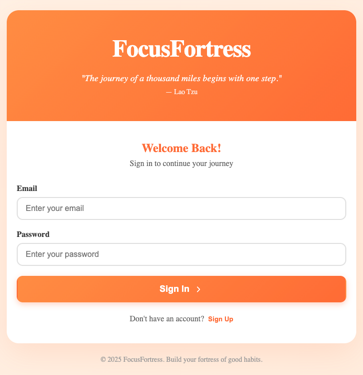
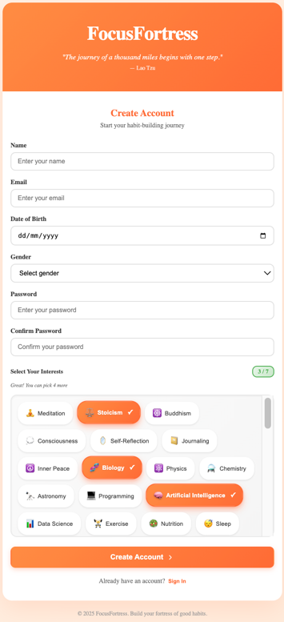
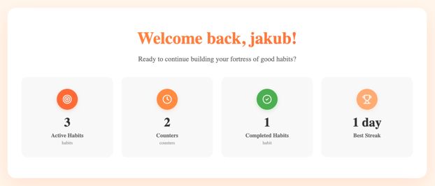
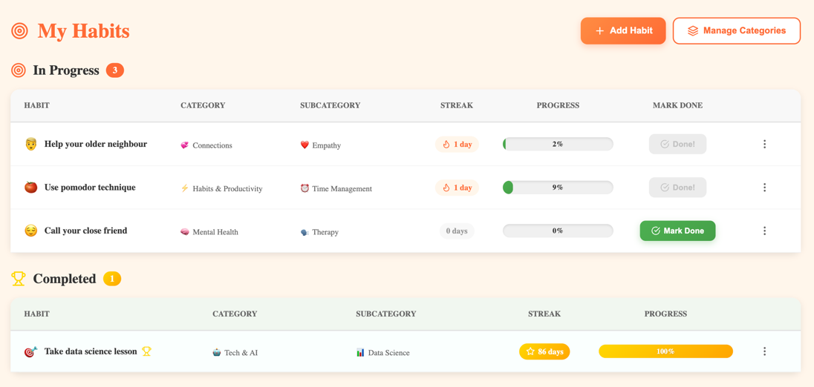
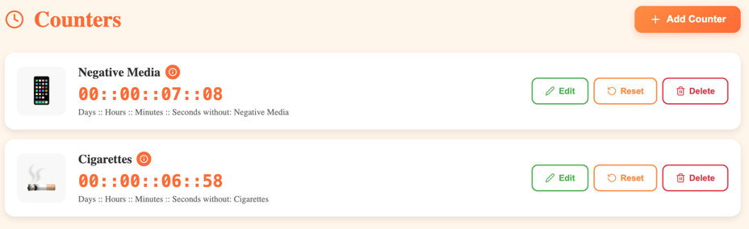
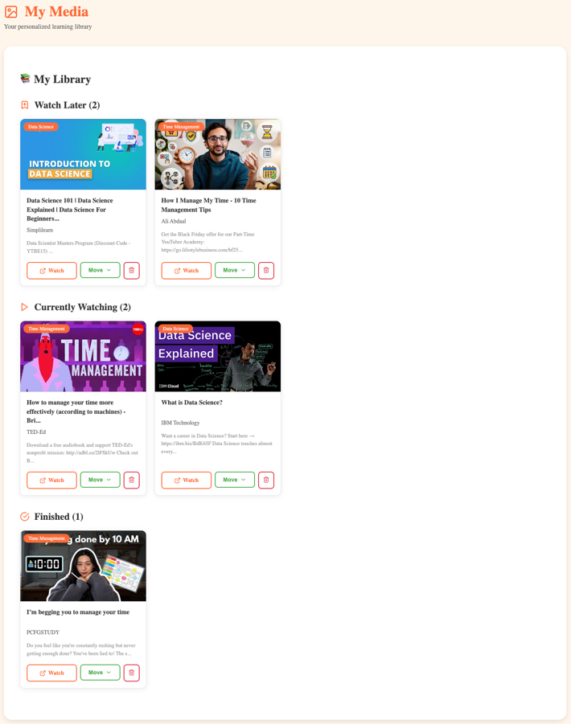

# FocusFortress

A comprehensive productivity and habit-tracking application built with Spring Boot and React. FocusFortress helps users build better habits, track their progress, and discover personalized content based on their interests.

[](https://github.com/HorydJakub/FocusFortress/actions/workflows/ci.yml)


## 🚀 Getting Started

### ⚙️ Configuration Setup (Required First)

Before running the application, you need to create configuration files:

1. **Clone the repository:**
   ```bash
   git clone https://github.com/yourusername/FocusFortress.git
   cd FocusFortress
   ```

2. **Copy example configuration files:**
   ```bash
   cd backend/src/main/resources
   cp application.properties.example application.properties
   cp application-docker.properties.example application-docker.properties
   ```

3. **Edit `application.properties` and `application-docker.properties`:**
   - Replace `YOUR_YOUTUBE_API_KEY_HERE` with your YouTube Data API v3 key
     - Get it from: https://console.cloud.google.com/apis/credentials
   - Replace `YOUR_GOOGLE_CLIENT_ID_HERE` and `YOUR_GOOGLE_CLIENT_SECRET_HERE` with your Google OAuth credentials
     - Get them from: https://console.cloud.google.com/apis/credentials
   - Update `jwt.secret` with a secure random string (at least 64 characters)

### 🐳 Docker Setup (Recommended way to run the project)

Run FocusFortress using Docker Compose:

```bash

# Start all services
docker compose up --build
```

**Access the application:**
- Frontend: http://localhost:3000
- Backend API: http://localhost:8080
- MailHog: http://localhost:8025
- MySQL: localhost:3306

**Stop the application:**
```bash
docker compose down
```
---

### 💻 Manual Setup (Alternative)

**Prerequisites:**
- Java 17 or higher
- Node.js 16+ and npm
- Maven 3.6+
- (Optional) MySQL 8.0+

#### Backend Setup

1. **Configure application properties**
   
   If you haven't already, copy the example files:
   ```bash
   cd backend/src/main/resources
   cp application.properties.example application.properties
   cp application-docker.properties.example application-docker.properties
   ```
   
   Edit `backend/src/main/resources/application.properties`:
   ```properties
   # Update JWT secret for production
   jwt.secret=your-secret-key-here
   
   # Configure YouTube API key
   youtube.api.key=your-youtube-api-key
   
   # Configure Google OAuth
   spring.security.oauth2.client.registration.google.client-id=your-client-id
   spring.security.oauth2.client.registration.google.client-secret=your-client-secret
   
   # For MySQL (optional)
   spring.datasource.url=jdbc:mysql://localhost:3306/focusfortress
   spring.datasource.username=your-username
   spring.datasource.password=your-password
   ```

2. **Build and run the backend**
   ```bash
   cd backend
   mvn clean install
   mvn spring-boot:run
   ```

   The backend will start at `http://localhost:8080`

#### Frontend Setup

1. **Install dependencies**
   ```bash
   cd frontend
   npm install
   ```

2. **Configure API endpoint**
   
   Edit `frontend/src/services/api.js` if needed (default: `http://localhost:8080`)

3. **Start the development server**
   ```bash
   npm start
   ```

   The frontend will start at `http://localhost:3000`

## ✨ Features


### 🎯 Habit Management
- Create and track daily habits
- Set habit duration (e.g., 21-day challenges)
- Visual progress tracking
- **Google Calendar integration** for automatic scheduling

### 📊 Counter System
- Track multiple activities with customizable counters
- Increment/decrement functionality
- Real-time counter updates

### 📺 Personalized Media Library
- **Interest-based content curation**
- Automatic YouTube video recommendations
- Category and subcategory organization
- Save and manage your favorite content

## 🏗️ Architecture

### Backend (Spring Boot)
- **RESTful API** design
- **Spring Security** for authentication and authorization
- **JPA/Hibernate** for database operations
- **H2 Database** (development) / **MySQL** (production ready)
- **JWT** token-based authentication
- **YouTube Data API v3** integration

### Frontend (React)
- **React 18.2** with functional components and hooks
- **React Router** for navigation
- **Axios** for API communication
- **Context API** for state management
- **Responsive design** with custom styling

## 🛠️ Technology Stack

### Backend
- **Java 17**
- **Spring Boot 3.4.2**
  - Spring Web
  - Spring Data JPA
  - Spring Security 6.4.3
  - Spring Validation
- **JWT (JJWT) 0.11.5**
- **Lombok 1.18.26**
- **H2 Database 2.3.232**
- **MySQL Connector 9.2.0**
- **Maven** (Build tool)

### Frontend
- **React 18.2.0**
- **React Router DOM 6.20.0**
- **Axios 1.6.0**
- **Lucide React** (Icons)
- **Emoji Picker React**


## 🧪 Testing

FocusFortress ships with a layered automated test suite that runs on every push to `master` and on every pull request.

### Test pyramid

| Layer | Location | Naming | Tooling | Runs in |
|---|---|---|---|---|
| **Unit** | `backend/src/test/java/com/focusfortress/unit` | `*Test.java` | JUnit 5, Mockito, AssertJ (no Spring context) | `mvn test` (Surefire) |
| **API** | `backend/src/test/java/com/focusfortress/api` | `*Test.java` | Spring Boot Test, H2 (profile `test`) | `mvn test` (Surefire) |
| **Integration** | `backend/src/test/java/com/focusfortress/it` | `*IT.java` | Testcontainers (MySQL), GreenMail | `mvn verify` (Failsafe) |
| **End-to-end** | `e2e/` | Playwright specs | Playwright (TypeScript) against the full Docker Compose stack | `npm test` in `e2e/` |

Unit tests cover the business rules in isolation: JWT generation/validation (expiry, remember-me lifetime, tampered and foreign-signed tokens), habit streak and completion logic (gaps, day boundaries, duplicate check-ins), counter ownership and partial updates, registration rules (password policy, interests 3–7, verification token flow) and DTO mapping. Defects found by the suite were first captured as `@Disabled("BUG: ...")` tests with the *expected* behaviour and then fixed, so each one is now guarded by a passing regression test.

> **Upgrading an existing database?** Run `triggers/migration_2026_10.sql` (instructions inside): it removes duplicate habit check-ins and migrates categories to per-user ownership.

### Running the tests locally

```bash
# Unit + API tests (no external dependencies)
mvn test

# Everything on the JVM side, incl. Testcontainers integration tests (requires Docker)
mvn verify

# End-to-end tests (requires the app running: docker compose up --build -d)
cd e2e
npm ci
npx playwright install --with-deps chromium
BASE_URL=http://localhost:3000 API_URL=http://localhost:8080/api MAILHOG_URL=http://localhost:8025 npm test
```

### Reports

| Report | Path |
|---|---|
| JUnit XML (unit + API) | `target/surefire-reports/` |
| JUnit XML (integration) | `target/failsafe-reports/` |
| JaCoCo coverage (unit + API) | `target/site/jacoco/index.html` |
| JaCoCo coverage (integration) | `target/site/jacoco-it/index.html` |
| Playwright HTML report | `e2e/playwright-report/index.html` (`npx playwright show-report`) |

### Continuous Integration

The [CI workflow](.github/workflows/ci.yml) (GitHub Actions) runs three jobs:

1. **Backend tests** – JDK 17 (Temurin), `mvn verify` running unit, API and Testcontainers integration tests. Results are published as a check run with inline annotations, a JaCoCo coverage table is added to the job summary and the HTML coverage report is uploaded as an artifact.
2. **Frontend build** – Node 20, production build of the React app.
3. **E2E tests** – after the backend job passes, the whole stack (MySQL, MailHog, backend, frontend) is started with Docker Compose, Playwright runs against it, and the HTML report is uploaded as an artifact. Container logs are dumped automatically when the job fails.

Superseded runs on the same branch are cancelled automatically, and the workflow uses least-privilege `GITHUB_TOKEN` permissions.

## 📁 Project Structure

```
FocusFortress/
├── backend/
│   └── src/
│       └── main/
│           ├── java/com/focusfortress/
│           │   ├── config/          # Security, CORS, etc.
│           │   ├── controller/      # REST endpoints
│           │   ├── dto/             # Data Transfer Objects
│           │   ├── exception/       # Custom exceptions
│           │   ├── mapper/          # Entity-DTO mappers
│           │   ├── model/           # JPA entities
│           │   ├── repository/      # Data access layer
│           │   ├── security/        # JWT, authentication
│           │   ├── service/         # Business logic
│           │   └── youtube/         # YouTube API integration
│           └── resources/
│               └── application.properties
├── frontend/
│   └── src/
│       ├── components/
│       │   ├── auth/         # Login, Register
│       │   ├── counters/     # Counter management
│       │   ├── dashboard/    # Main dashboard
│       │   ├── habits/       # Habit tracking
│       │   ├── layout/       # App layout
│       │   ├── media/        # Media library
│       │   └── settings/     # User settings
│       ├── context/          # React Context
│       └── services/         # API services
├── architecture_diagrams/    # C4 model diagrams
└── pom.xml
```

## 📸 Screenshots

### Authentication


### Registration Page


### Dashboard

*Main dashboard overview with quick access to all features*

### Habit Tracking

*Track your habits and sync with Google Calendar*

### Counter Management

*Manage multiple counters for various activities*

### Media Library: My Media

*Your personalized collection of saved YouTube videos*

### Media Library: Discover Personalized Content

*Personalized YouTube content based on your interests*

## 🔑 API Endpoints

### Authentication
- `POST /api/users/register` - Register new user
- `POST /api/users/login` - User login
- `GET /api/users/me` - Get current user

### Habits
- `GET /api/habits` - Get all user habits
- `POST /api/habits` - Create new habit
- `PUT /api/habits/{id}` - Update habit
- `DELETE /api/habits/{id}` - Delete habit

### Counters
- `GET /api/counters` - Get all user counters
- `POST /api/counters` - Create new counter
- `PUT /api/counters/{id}` - Update counter
- `DELETE /api/counters/{id}` - Delete counter

### Media Library
- `GET /api/media-library` - Get user's media items
- `POST /api/media-library` - Add media item
- `DELETE /api/media-library/{id}` - Remove media item

### Interests & Categories
- `GET /api/interests` - Get all available interests
- `POST /api/user-interests` - Set user interests
- `GET /api/categories` - Get category tree


---

**Happy Habit Building :)**

